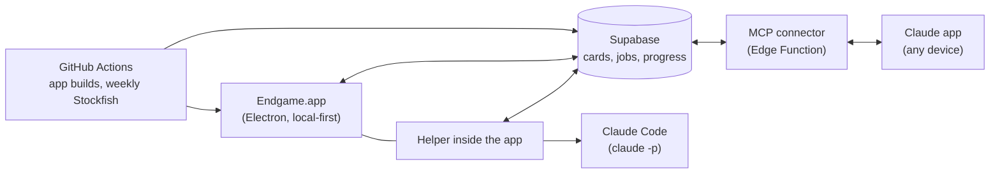

# Endgame

**A daily paper that actually ends.** Read every story, lesson and puzzle, then close the laptop.

Every feed app is built so you never reach the bottom. Endgame is the opposite: each day is one newspaper with a fixed set of cards (real news, coding and stock-market lessons, history, chess, Italian, one thing to watch, a sudoku and a mini crossword). Every card is **Done** or **Skip**. When they're all cleared, the app tells you to close the laptop.

It's a personal Mac app. All of its AI work runs on my own Claude subscription through Claude Code on the same Mac, so it costs nothing to run.

**Want something like this on your Mac?** Email me at satwik.medipalli@gmail.com.

## What a day looks like

- **A newspaper you page through**: a front page with the top stories and an "Inside today" index, then sections (Politics & world, Business, Tech & science, Sports, More news). Swipe with two fingers, press → or use the section tabs to turn the page.
- **A break between sections**: pages with the day's lessons, history stories, puzzles and the watch pick, mixed three to a page.
- **Salmon by day, Sepia at night**: pink newsprint with warm ink and claret for the lead; after sunset, dark brown with parchment type and amber (sunrise and sunset worked out for Richardson, TX). The Dock icon switches with it.
- **Stories open as paper**: click a story and it slides up as a sheet over the page. ← → goes to the next story, **D** is Done, **S** is Skip, Esc puts it away and returns you to that story's page.
- **News**: 38 stories (US, India, world) from 22 RSS feeds. Duplicates are merged, opinion pieces are dropped, and each card is written only from its sources.
- **Coding and stocks**: lessons that follow a syllabus and remember what you finished. A lesson is written the moment you open it, never ahead of time.
- **Chess**: drills built from positions in my own Chess.com games, plus reviews of my own mistakes found by Stockfish. Claude never invents a position. Every board is replayed move by move with chess.js.
- **Italian**: A1 to C1 in 10 minutes a day, with spaced-repetition review (SM-2) and the Mac's Italian voice on every phrase.
- **History and one thing to watch**: picks that learn from what I open, finish and skip, and never repeat.
- **Sudoku and a mini crossword**: the sudoku is made entirely in code (one solution, easier on Monday, harder at the weekend). The crossword grid is filled in code from a list of everyday words; Claude only writes the clues.
- **Chat on any card**: ask a follow-up (⌘K) and the reply arrives in a few seconds.

## How it works

- **The window never calls an AI model.** It writes a job (a lesson to write, a chat question) to Supabase.
- **The helper runs inside the app** and picks the job up through Realtime (with a 20-second poll as a backstop). It runs headless Claude Code, which bills a Claude subscription, not the paid API. Closing the window keeps Endgame in the menu bar ("12 left", then ✓) so the helper keeps working.
- **It updates itself.** Every merge to `main` is built by a GitHub Action and published to the `app-build` branch; the app checks it when it opens and every few hours, then offers "Update ready · Restart".
- **Away from the Mac,** "Discuss in Claude" opens the Claude app on a card. A small MCP server on Supabase lets Claude read the card, the course notes and the chat so far, and save a one-line summary back. It can't edit or delete anything.
- **The app works offline.** Progress is saved on the Mac first, then synced, so pressing Done never waits for the network.

## Built with care

- **Tests** for the feed rules, the paper's pages and sections, sync and merge, spaced repetition, sudoku (unique solutions) and crossword fills (every answer a real word), plus the helper's news, lessons and chess; type checks on everything.
- **Cheap on usage by design**: lessons are written only when opened, Haiku does the triage and the crossword clues, Sonnet does the writing, and once something is written it's stored, never rewritten.
- **Locked down**: one user, signups closed by an Auth setting and a database trigger, row-level security on every table, the login kept in a chmod-600 file, and no Anthropic API key anywhere in the code.
- **Every decision written down**: [`DECISIONS.md`](endgame/DECISIONS.md) records why each choice was made, milestone by milestone.

## Stack

Electron · React · TypeScript · Vite · Supabase (Postgres, Auth, Realtime, Edge Functions) · Claude Code · MCP · chess.js · Stockfish · GitHub Actions

## Run it yourself

Setup, the connector and every command are in [`endgame/README.md`](endgame/README.md). You need a Mac, a free Supabase project and a Claude plan.
