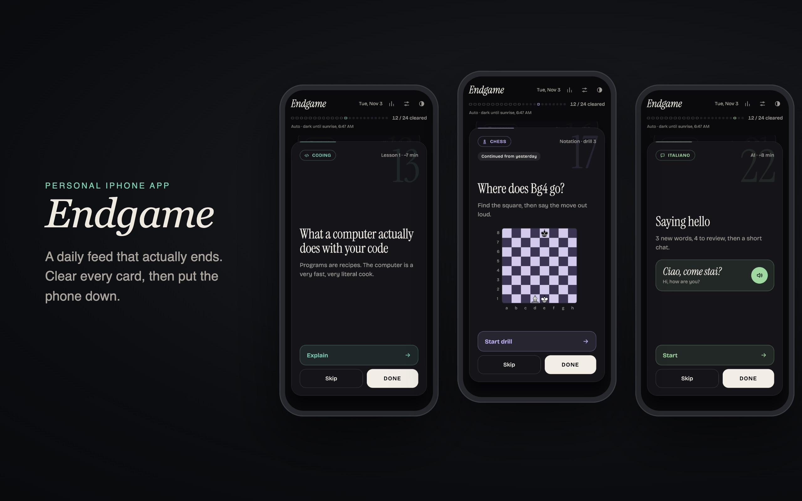
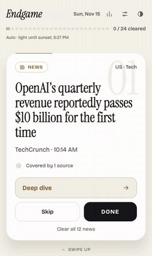
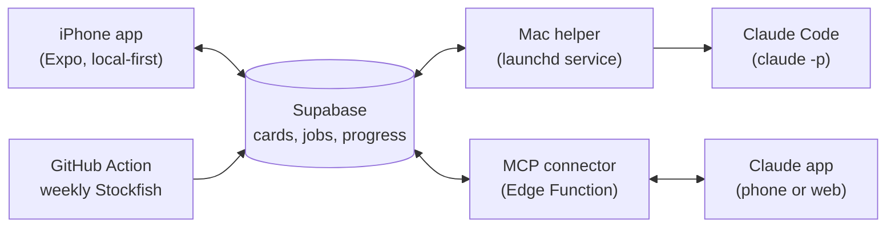

# Endgame

**A daily feed that actually ends.** Clear every card, then put the phone down.

**[Try the live demo →](https://endgame-silk.vercel.app)** (best on a phone, or in a narrow browser window)

The demo runs entirely in your browser with a sample day. Its news cards are 12 real ones from a Sync on November 11, 2026. It isn't connected to a database or to Claude, so chat replies won't arrive.

Every feed app is built so you never reach the bottom. Endgame is the opposite: each day is a fixed set of cards (real news, coding and stock-market lessons, history, chess, Italian, and one thing to watch). Every card is **Done** or **Skip**. When they're all cleared, the app tells you to close your phone.

It's a personal app, built for my own iPhone. All of its AI work runs on my own Claude subscription, through Claude Code on my Mac, so it costs nothing to run.

## What a day looks like

- **News**: 38 stories (US, India, world) from 22 RSS feeds. Duplicates are merged, opinion pieces are dropped, and each card is written only from its sources.
- **Coding and stocks**: lessons that follow a syllabus and remember what you finished. A lesson is written the moment you open it, never ahead of time.
- **Chess**: drills built from positions in my own Chess.com games, plus reviews of my own mistakes found by Stockfish. Claude never invents a position. Every board is replayed move by move with chess.js.
- **Italian**: A1 to C1 in 10 minutes a day, with spaced-repetition review (SM-2) and a speaker button on every phrase.
- **History and one thing to watch**: picks that learn from what I open, finish and skip, and never repeat.
- **Chat on any card**: ask a follow-up and the reply arrives in a few seconds.

## How it works

- **The phone never calls an AI model.** It writes a job (a lesson to write, a chat question) to Supabase.
- **A helper on the Mac picks up the job** and runs headless Claude Code, which bills a Claude subscription, not the paid API. It hears about jobs through Realtime and also checks every 20 seconds, so nothing is lost while the Mac sleeps.
- **When the Mac is off,** "Discuss in Claude" opens the Claude app on that card. A small MCP server on Supabase lets Claude read the card, the course notes and the chat so far, and save a one-line summary back. It can't edit or delete anything.
- **The app works offline.** Progress is saved on the phone first, then synced, so tapping Done never waits for the network.

## Built with care

- **108 tests**: 65 in the app and 43 in the helper, plus type checks on both.
- **Cheap on usage by design**: lessons are written only when opened, Haiku does the triage, Sonnet does the writing, and once a lesson is written it's stored, never rewritten.
- **Locked down**: one user, signups closed by an Auth setting and a database trigger, row-level security on every table, and no Anthropic API key anywhere in the code.
- **Every decision written down**: [`DECISIONS.md`](endgame/DECISIONS.md) records why each choice was made, milestone by milestone.

## Stack

Expo (React Native) · TypeScript · Supabase (Postgres, Auth, Realtime, Edge Functions) · Node · Claude Code · MCP · chess.js · Stockfish · GitHub Actions

## Run it yourself

Setup, the helper, the connector and every command are in [`endgame/README.md`](endgame/README.md). You need a Mac, a free Supabase project and a Claude plan.
